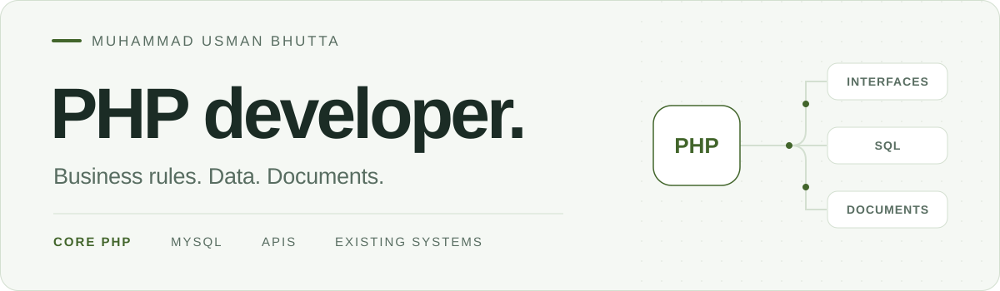

<picture>
  <source media="(prefers-color-scheme: dark)" srcset="assets/banner-dark.svg">
  <source media="(prefers-color-scheme: light)" srcset="assets/banner-light.svg">
  
</picture>

# Hi, I'm Usman.

**PHP developer working on existing products, business systems and document workflows.**

I maintain and extend applications where forms, database records, permissions and generated documents need to agree. My work spans procedural and object-oriented PHP, SQL, JSON APIs and administrative interfaces.

  
  

## What I work on

- **Existing PHP systems** — trace business rules, extend procedural entry points and domain classes, and make focused compatibility fixes.
- **Data and access** — work with SQL queries, transactions, company-scoped permissions, OTP workflows and validation.
- **APIs and interfaces** — connect JSON responses and callbacks to forms through JavaScript, jQuery and AJAX.
- **Documents and reports** — maintain queued DOCX/PDF generation and investigate spreadsheet compatibility issues.

## My toolkit

`Core PHP` · `OOP / procedural PHP` · `MySQL` · `SQL`  
`JavaScript` · `jQuery` · `AJAX` · `HTML / CSS`  
`JSON APIs` · `Git` · `DOCX / PDF` · `PhpSpreadsheet`

I have also contributed to Laravel/Eloquent document-generation workflows. I choose changes that fit the application and its existing behavior.

## Selected engineering work

### [01 · Audit & document operations](https://usman-bhutta-portfolio.workspace-at-6143.chatgpt.site/projects/audit-platform/index.html)

Contributions to an established PHP product: form synchronization that preserves saved answers, company-scoped permissions, queued documents and audit-specific validation.

### [02 · Document generation & reporting](https://usman-bhutta-portfolio.workspace-at-6143.chatgpt.site/projects/document-reporting/index.html)

Extended generation jobs with persisted processing states and after-commit dispatch. Added targeted workbook cleanup and resource release in reporting workflows.

### [03 · Verification reviews & callbacks](https://usman-bhutta-portfolio.workspace-at-6143.chatgpt.site/projects/verification-workflows/index.html)

Contributed to verification-review workflows and callback handling, with checks tied to the relevant account, document and integration context.

These are selected contributions to existing systems. The portfolio explains my scope and technical approach through anonymized case studies.

<strong>How I approach an existing system</strong>

- Trace the entry point, data flow and business rules before changing behavior.
- Keep database state, API responses, interfaces and generated documents consistent.
- Check access boundaries, failure paths and backward compatibility.
- Use focused regression checks for the behavior being changed.

---

**Want the full picture?** [Explore my portfolio](https://usman-bhutta-portfolio.workspace-at-6143.chatgpt.site/) · [View my CV](https://usman-bhutta-portfolio.workspace-at-6143.chatgpt.site/documents/index.html)
