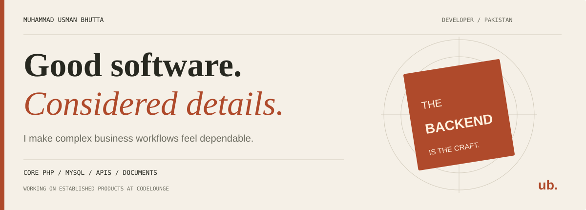
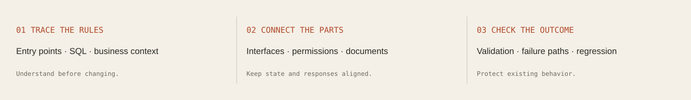

<h2>A developer who cares about how things hold together.</h2>

I’m Muhammad Usman Bhutta, a PHP developer at CodeLounge, based in Pakistan. I work on established products — turning business rules, forms, data and document workflows into useful, dependable software.

<h2>My toolkit</h2>
<table><tr><th align="left">Systems & data</th><th align="left">Interfaces & workflows</th><th align="left">Practical tools</th></tr><tr><td>Core PHP · OOP / procedural MySQL · SQL</td><td>JSON APIs · JavaScript jQuery · AJAX · HTML / CSS</td><td>Git · DOCX / PDF PhpSpreadsheet</td></tr></table>

<h2>Selected engineering work</h2>
<h3><a href="https://usman-bhutta-portfolio.workspace-at-6143.chatgpt.site/projects/audit-platform/index.html">01 · Audit & document operations ↗</a></h3>

Form synchronization, company-scoped access, queued documents and context-aware validation.

<h3><a href="https://usman-bhutta-portfolio.workspace-at-6143.chatgpt.site/projects/document-reporting/index.html">02 · Documents & reporting ↗</a></h3>

Generation jobs, persisted processing states, after-commit dispatch and workbook compatibility.

<h3><a href="https://usman-bhutta-portfolio.workspace-at-6143.chatgpt.site/projects/verification-workflows/index.html">03 · Reviews & callbacks ↗</a></h3>

Verification-review workflows and callback handling tied to the relevant account and document.

Selected contributions to established products. Case studies explain my scope and approach with operational details anonymized.

<h2>How I approach a system</h2>

<strong>A few principles I work by</strong>

<ul><li>Understand the existing behavior before changing it.</li><li>Keep database state, API responses and generated documents consistent.</li><li>Check access boundaries, failure paths and backward compatibility.</li><li>Use focused regression checks for the behavior being changed.</li></ul>

<h2>Let’s connect</h2>

<a href="mailto:musmankhan7074@gmail.com">musmankhan7074@gmail.com</a> · <a href="https://www.linkedin.com/in/musmanbhutta29/">LinkedIn</a> · <a href="https://usman-bhutta-portfolio.workspace-at-6143.chatgpt.site/">Portfolio</a> Phone: +92 344 2150929

